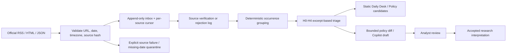

# Official macro event intake contract

Phase/Gate: V2 Product Build, Epic #8 Stage 1 source confirmation feeding Stage 2 #4/#10. §15.2: (1) **Yes**, source/time identity makes What Changed trustworthy; (2) **Yes**, runner measurements are real source-availability evidence; (3) **No**, a model is unnecessary for HTTP/parsing; (4) **Yes**, source access and timezone failures were observed in the existing workflow/review; (5) **Yes**, source-linked daily/policy pages are an authorized V2 deliverable. Infrastructure justification: without measured response shapes and dates, the Daily Desk cannot distinguish unavailable official data from an empty news day. This issue only extends the existing probe and writes these three documents.

## One item contract, one inbox

The following is the shared contract specified in Issues #4/#10, not a second news store:

```text
BriefingItem
  item_id                          stable source identity
  kind                             data_release | policy | announcement | media
  title_zh, title_en                original + optional faithful translation; no invented English
  publisher, canonical_url          official issuer and original source link
  published_at                     trustworthy source timestamp, nullable until verified
  publication_precision            second | minute | date | unknown
  first_seen_at, retrieved_at       actual collection timestamps, timezone-aware
  source_hash                      hash of source content, not analyst interpretation
  metric_ids[], hypotheses[]        links; an H-link later carries its supporting excerpt
  event_id?, stage?                 signal | announced | funded | implementation | observed_impact
  tier                             FACT | EVENT | EXTERNAL_VIEW
  status                           raw_candidate | verified | analyst_approved | rejected
  summary_zh?, summary_en?          short literal excerpt, at most 300 characters
  archived                         first seen >48h after publication
```

The initial authorized sources produce EVENT items. They do not create FACT observations. The already-existing refresh records provide the Daily Desk v1 FACT release entries independently of intake. `media`/EXTERNAL_VIEW are schema vocabulary, not permission to collect media or brokerage research this round.



## Storage and boundaries

- `data/events/inbox/YYYY-MM.jsonl` appends new identities/revisions; `data/events/cursors.json` tracks only successful source progress. Scanning retained source history handles failures/backfill; a last-24h cutoff loses low-frequency releases.
- Review status changes append to a separate log. Verification checks source identity/date; approval is human research judgment. Neither operation rewrites raw items.
- `data/events/events.jsonl` groups occurrences and links a separate implementation event with SAME_STORY. It carries H excerpts, mechanism, next confirmation, triage reason and figures only as literal source quotes.
- `events.yml` writes only `data/events/`. Existing `refresh.yml` remains the writer for public observations/evidence artifacts. No candidate promotes itself into `research/cases/cn-nominal/policy_events.yaml`.
- The static build writes `data/briefing.json`; no browser API key, runtime crawler, server or database is introduced.

## Relevance is not attention

Triage is `irrelevant | monitor | research_needed`. A prominent announcement can be irrelevant to nominal growth. An H0–H4 link needs a literal excerpt and a mechanism; it does not imply a change in probability or evidence-test result. With no model key, deterministic facts/diffs remain available and ambiguous relations remain ungrouped. A model run, when explicitly configured in later issues, needs existing append-only Run Record/allowlist/hard-gate machinery.

## Acceptance and bounded next work

The source probe logs real counts/failures and preserves responses for parser fixtures. #4 tests time handling, idempotency, explicit failure/backfill and missing-date hiding with those fixtures. #5 supplies real relation examples; #6 supplies a real text pair. #7's analyst labels and judgments cannot be manufactured by an agent. None of this issue changes a source provider, preregistration, probability, mechanical delta or historical research record.
